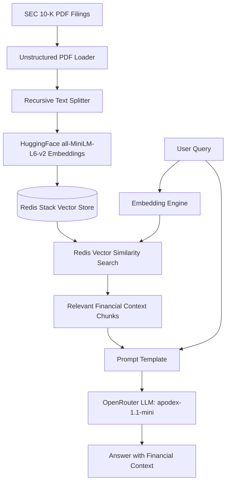

# 📊 Financial Document RAG with LangChain & Redis Stack

[](https://python.org)
[](https://python.langchain.com)
[](https://redis.io)
[](https://openrouter.ai)
[](https://www.docker.com)

A high-performance **Retrieval-Augmented Generation (RAG)** system designed to perform intelligent semantic search and question-answering over complex corporate financial filings (SEC Form 10-K).

Powered by **Redis Stack** as the real-time vector database, **LangChain** for pipeline orchestration, local **HuggingFace** sentence-transformers for vector embeddings, and **OpenRouter** for LLM generation.

---

## 🏛️ Architecture Overview



---

## ✨ Features

- **⚡ Blazing-Fast Vector Search**: Leverages Redis Stack's native vector similarity search (`langchain-redis` & `redisvl`).
- **🔍 Hybrid Filtering**: Search with combined metadata tags, distance thresholds, and full-text keyword filters.
- **📄 Robust Document Parsing**: Extracts structured sections from complex financial PDFs using `unstructured`.
- **🧠 Zero-Cost Local Embeddings**: Generates dense 384-dimensional embeddings locally with `sentence-transformers/all-MiniLM-L6-v2` (no embedding API fees).
- **🌐 OpenRouter Multi-Model Support**: Easily switch LLMs via OpenRouter (defaults to free tier `apodex/apodex-1.1-mini:free`).
- **📊 RedisInsight GUI**: Real-time visual dashboard to inspect vector keys, indexes, and document payloads at `http://localhost:8001`.
- **💻 Dual Interface**: Run interactively via the **CLI script** (`main.py`) or explore step-by-step via the **Jupyter Notebook** (`02_langchain.ipynb`).

---

## 📁 Repository Structure

```text
├── .env.example              # Template for environment variables
├── .gitignore                # Production Python/Docker/IDE gitignore
├── docker-compose.yml        # Docker service definition for Redis Stack + RedisInsight
├── requirements.txt          # Python project dependencies
├── main.py                   # Production CLI application for RAG queries & ingestion
├── 02_langchain.ipynb        # Step-by-step interactive Jupyter Notebook
└── resources/                # Sample corporate financial filings (SEC 10-K PDFs)
    ├── nke-10k-2023.pdf      # NIKE, Inc. 2023 Form 10-K
    ├── aapl-10k-2023.pdf     # Apple Inc. 2023 Form 10-K
    ├── msft-10k-2023.pdf     # Microsoft Corp. 2023 Form 10-K
    └── amzn-10k-2023.pdf     # Amazon.com, Inc. 2023 Form 10-K
```

---

## 🚀 Quickstart Guide

### 1. Prerequisites
- **Python**: 3.12 (Python < 3.13 is recommended for compatibility with PyTorch/Unstructured)
- **Docker Desktop**: For running the Redis Stack container
- **OpenRouter API Key**: Free key from [openrouter.ai/keys](https://openrouter.ai/keys)

---

### 2. Start Redis Stack (Docker)

Spin up Redis Stack and RedisInsight with Docker Compose:

```bash
docker compose up -d
```

- **Redis Server (Port 6379)**: Real-time vector store
- **RedisInsight GUI (Port 8001)**: Open [http://localhost:8001](http://localhost:8001) in your browser to inspect vectors

---

### 3. Setup Python Virtual Environment

```bash
# Create virtual environment
python -m venv .venv

# Activate virtual environment
# Windows (PowerShell):
.\.venv\Scripts\Activate.ps1
# Linux / macOS:
source .venv/bin/activate

# Install dependencies
pip install --upgrade pip
pip install -r requirements.txt
```

---

### 4. Configure Environment Variables

Create your `.env` file from the example:

```bash
cp .env.example .env
```

Edit `.env` with your API key:
```env
OPENROUTER_API_KEY=sk-or-v1-your-key-here
OPENROUTER_MODEL=apodex/apodex-1.1-mini:free
REDIS_HOST=localhost
REDIS_PORT=6379
REDIS_PASSWORD=
```

---

## 🛠️ Usage

### Option A: Command-Line Interface (`main.py`)

#### 1. Ask a specific question:
```bash
python main.py --query "What was Nike's revenue in fiscal 2023 compared to 2022?"
```

#### 2. Interactive Q&A Mode:
```bash
python main.py --interactive
```

```text
============================================================
 Financial Document RAG Pipeline (Redis + LangChain)
============================================================
Ask a question: What drove Nike's direct-to-consumer growth?
Thinking...

Answer:
Based on the filing, NIKE Direct revenues increased 14% to $21.3 billion, 
primarily driven by NIKE Brand Digital sales growth of 24% and comparable 
store sales growth of 14%...
```

#### 3. CLI Options:
```text
  --query, -q        Question to ask the RAG pipeline
  --doc, -d          Path to PDF document (default: resources/nke-10k-2023.pdf)
  --reindex          Force re-indexing and embedding of documents in Redis
  --interactive, -i  Enter continuous interactive conversational mode
  --model, -m        Override the OpenRouter LLM model name
```

---

### Option B: Interactive Jupyter Notebook (`02_langchain.ipynb`)

1. Open `02_langchain.ipynb` in VS Code or JupyterLab.
2. Select kernel **`Python 3.12 (radis-langchain)`** (or your `.venv` interpreter).
3. Run the cells sequentially to observe:
   - Document loading and semantic chunking
   - Embedding generation with HuggingFace
   - Index creation in Redis Stack
   - Metadata filtering & vector threshold querying
   - Final end-to-end RAG chain generation

---

## 🧹 Maintenance & Cleanup

To stop and remove the Redis Docker container:
```bash
docker compose down
```

To clear vector data in Redis, use the cleanup section in the notebook or delete the index via CLI:
```python
from redisvl.index import SearchIndex
SearchIndex.from_existing("financial_10k_rag", redis_url="redis://localhost:6379").delete()
```

---

## 📜 License
MIT License. Created by Vivek.
