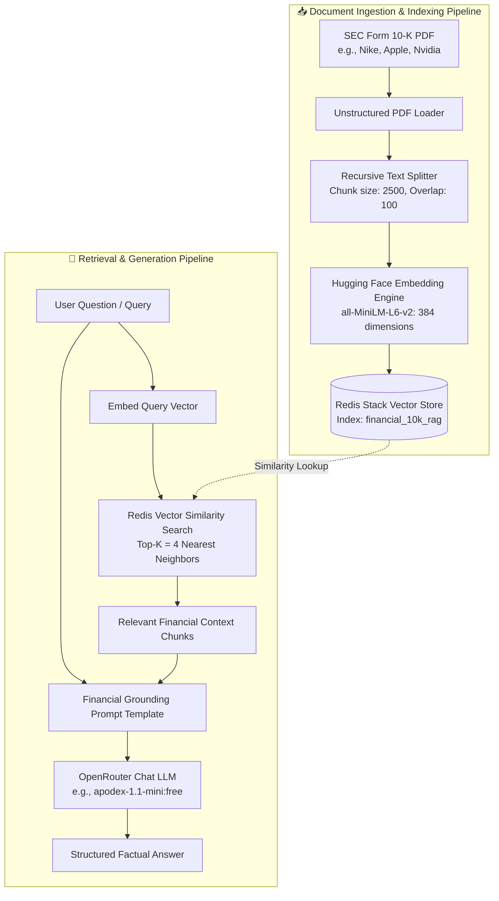

# 📊 Financial Document RAG with LangChain & Redis Stack

[](https://python.org)
[](https://python.langchain.com)
[](https://redis.io)
[](https://huggingface.co/sentence-transformers/all-MiniLM-L6-v2)
[](https://openrouter.ai)
[](https://www.docker.com)
[](LICENSE)

A high-performance **Retrieval-Augmented Generation (RAG)** system engineered for semantic search, factual question-answering, and financial analysis over corporate SEC Form 10-K filings.

Powered by **Redis Stack** as the real-time vector database, **LangChain** for LCEL pipeline orchestration, local **Hugging Face** sentence-transformers for zero-cost dense embeddings, and **OpenRouter** for multi-model LLM generation.

---

## 📑 Table of Contents

- [Architecture Overview](#-architecture-overview)
- [Key Features](#-key-features)
- [Repository Structure](#-repository-structure)
- [Quickstart Guide](#-quickstart-guide)
  - [1. Prerequisites](#1-prerequisites)
  - [2. Start Redis Stack (Docker)](#2-start-redis-stack-docker)
  - [3. Setup Python Virtual Environment](#3-setup-python-virtual-environment)
  - [4. Configure Environment Variables](#4-configure-environment-variables)
- [Usage & Execution](#-usage--execution)
  - [Option A: Command-Line Interface (`main.py`)](#option-a-command-line-interface-mainpy)
  - [Option B: Interactive Jupyter Notebook (`langchain book.ipynb`)](#option-b-interactive-jupyter-notebook-langchain-bookipynb)
- [Inspecting Vectors with RedisInsight](#-inspecting-vectors-with-redisinsight)
- [Technical Architecture & Specifications](#-technical-architecture--specifications)
- [Troubleshooting & FAQ](#-troubleshooting--faq)
- [License](#-license)

---

## 🏛️ Architecture Overview

The system operates in two core phases: **Document Ingestion & Vector Indexing** and **Query Retrieval & Grounded Generation**.



---

## ✨ Key Features

- **⚡ Sub-Millisecond Vector Retrieval**: Powered by Redis Stack's in-memory vector search engine via `langchain-redis` and `redisvl`.
- **📄 Native SEC 10-K Parsing**: Ingests and extracts clean textual elements from complex multi-page financial filings using `unstructured[pdf]`.
- **🧠 Zero-Cost Local Embeddings**: Generates dense 384-dimensional vector embeddings locally using `sentence-transformers/all-MiniLM-L6-v2`, requiring zero embedding API billing.
- **🌐 OpenRouter Model Flexibility**: Native support for any OpenAI-compatible OpenRouter endpoint (defaults to the free-tier `apodex/apodex-1.1-mini:free`, easily swappable with Llama 3, Claude 3.5, or GPT-4o).
- **🛡️ Smart Re-indexing Guard**: Checks for existing Redis vector index definitions to avoid redundant parsing and embedding on recurring runs unless explicitly requested with `--reindex`.
- **💻 Flexible Interfaces**:
  - **CLI (`main.py`)**: Supports single queries, interactive REPL conversation mode, custom document selection, and model overrides.
  - **Jupyter Notebook (`langchain book.ipynb`)**: Fully executed, step-by-step interactive workflow with inline outputs and inspection cells.
- **📊 Real-time Visual Inspection**: RedisInsight GUI integrated out of the box at `http://localhost:8001` to view vector keys, metadata hashes, and search metrics.

---

## 📁 Repository Structure

```text
radis-langchain/
├── .env.example              # Template for environment configuration
├── .gitignore                # Production Python, Docker, and IDE gitignore
├── docker-compose.yml        # Docker Compose configuration for Redis Stack + RedisInsight
├── requirements.txt          # Python dependencies (LangChain, RedisVL, PyTorch, Unstructured)
├── main.py                   # Production CLI application for RAG queries & ingestion
├── langchain book.ipynb      # Step-by-step interactive Jupyter Notebook with live outputs
└── resources/                # Sample corporate SEC Form 10-K annual filings (2023)
    ├── aapl-10k-2023.pdf     # Apple Inc. Form 10-K
    ├── amzn-10k-2023.pdf     # Amazon.com, Inc. Form 10-K
    ├── jnj-10k-2023.pdf      # Johnson & Johnson Form 10-K
    ├── msft-10k-2023.pdf     # Microsoft Corporation Form 10-K
    ├── nke-10k-2023.pdf      # NIKE, Inc. Form 10-K (Default)
    └── nvd-10k-2023.pdf      # NVIDIA Corporation Form 10-K
```

---

## 🚀 Quickstart Guide

### 1. Prerequisites

- **Python**: `3.12` (Python 3.12 is strongly recommended for binary compatibility with PyTorch and Unstructured)
- **Docker & Docker Compose**: Installed and running (e.g. Docker Desktop)
- **OpenRouter API Key**: A free API key from [openrouter.ai/keys](https://openrouter.ai/keys)

---

### 2. Start Redis Stack (Docker)

Spin up Redis Stack (including Redis Search, JSON, and RedisInsight) using Docker Compose:

```bash
docker compose up -d
```

Verify that the container is healthy:
```bash
docker ps
```

- **Redis Vector Database**: Port `6379`
- **RedisInsight Web GUI**: Port `8001` (accessible at [http://localhost:8001](http://localhost:8001))

---

### 3. Setup Python Virtual Environment

Create and activate a virtual environment:

#### Windows (PowerShell):
```powershell
python -m venv .venv
.\.venv\Scripts\Activate.ps1
```

#### Windows (Command Prompt):
```cmd
python -m venv .venv
.\.venv\Scripts\activate.bat
```

#### Linux / macOS:
```bash
python3 -m venv .venv
source .venv/bin/activate
```

Install the required dependencies:
```bash
pip install --upgrade pip
pip install -r requirements.txt
```

---

### 4. Configure Environment Variables

Create your `.env` file from the example template:

#### Windows (PowerShell):
```powershell
Copy-Item .env.example .env
```

#### Linux / macOS / Bash:
```bash
cp .env.example .env
```

Open `.env` and fill in your OpenRouter API key:

```env
# OpenRouter API Key (Get yours at https://openrouter.ai/keys)
OPENROUTER_API_KEY=sk-or-v1-your-actual-api-key-here

# OpenRouter Model Name (Default: apodex/apodex-1.1-mini:free)
OPENROUTER_MODEL=apodex/apodex-1.1-mini:free

# Redis Stack Connection (Local Docker defaults)
REDIS_HOST=localhost
REDIS_PORT=6379
REDIS_PASSWORD=
```

| Variable | Description | Default |
| :--- | :--- | :--- |
| `OPENROUTER_API_KEY` | Your OpenRouter secret key | *Required* |
| `OPENROUTER_MODEL` | Default model identifier | `apodex/apodex-1.1-mini:free` |
| `REDIS_HOST` | Hostname of the Redis Stack instance | `localhost` |
| `REDIS_PORT` | Port of the Redis Stack instance | `6379` |
| `REDIS_PASSWORD` | Optional Redis authentication password | *Empty (None)* |

---

## 🛠️ Usage & Execution

### Option A: Command-Line Interface (`main.py`)

The CLI provides full control over querying, re-indexing, document selection, and interactive conversation.

#### 1. Ask a Single Question (Default Document: Nike 10-K):
```bash
python main.py --query "What was Nike's revenue in fiscal 2023 compared to 2022?"
```

#### 2. Query a Different Company Filing:
Pass any PDF file from `resources/` (or your own custom PDF filing):
```bash
python main.py --doc resources/nvd-10k-2023.pdf --query "What were Nvidia's main revenue drivers in 2023?"
```

```bash
python main.py --doc resources/aapl-10k-2023.pdf --query "What was Apple's total net sales in 2023?"
```

#### 3. Interactive Q&A Mode:
Launch a continuous chat session to ask consecutive questions:
```bash
python main.py --interactive
```

Sample interactive session:
```text
============================================================
 Financial Document RAG Pipeline (Redis + LangChain)
============================================================
 Redis Endpoint:  redis://localhost:6379
 LLM Model:       apodex/apodex-1.1-mini:free
============================================================
[INFO] Using existing Redis vector index: 'financial_10k_rag'

[INFO] Entering interactive mode. Type 'exit' or 'quit' to stop.

Ask a question: What drove Nike's direct-to-consumer growth?

Thinking...

Answer:
Based on the filing, NIKE Direct revenues increased 14% to $21.3 billion,
primarily driven by NIKE Brand Digital sales growth of 24% and comparable
store sales growth of 14%...
------------------------------------------------------------
Ask a question: exit
Goodbye!
```

#### 4. Force Document Re-indexing:
To overwrite and recreate the vector index from scratch:
```bash
python main.py --reindex --doc resources/msft-10k-2023.pdf
```

#### 5. CLI Arguments Reference:
| Argument | Shorthand | Type | Description | Default |
| :--- | :--- | :--- | :--- | :--- |
| `--query` | `-q` | string | Question to ask the RAG pipeline | Runs sample query |
| `--doc` | `-d` | string | Path to target SEC 10-K PDF filing | `resources/nke-10k-2023.pdf` |
| `--interactive` | `-i` | flag | Enters continuous REPL query mode | `False` |
| `--reindex` | | flag | Re-parses and re-embeds document into Redis | `False` |
| `--model` | `-m` | string | Override OpenRouter LLM model | Value from `.env` |

---

### Option B: Interactive Jupyter Notebook (`langchain book.ipynb`)

For visual inspection, exploratory analysis, and educational walkthroughs, use the notebook:

1. Open `langchain book.ipynb` in VS Code or JupyterLab.
2. Select the Python kernel pointing to your virtual environment (`.venv`).
3. Execute the cells sequentially to experience:
   - **Environment Verification**: Connects to Redis and loads configuration.
   - **Document Parsing**: Loads filings using `UnstructuredLoader` and `RecursiveCharacterTextSplitter`.
   - **Local Embeddings**: Generates dense 384-dim vectors with Hugging Face `all-MiniLM-L6-v2`.
   - **Index Creation**: Creates and initializes the `financial_10k_rag` index in Redis Stack.
   - **Similarity Search**: Performs raw vector distance searches with scores.
   - **LCEL Chain Orchestration**: Binds the prompt, OpenRouter LLM, and string parser into a runnable pipeline.
   - **Index Cleanup**: Demonstrates how to programmatically remove the index using `redisvl`.

---

## 🔍 Inspecting Vectors with RedisInsight

Redis Stack includes **RedisInsight**, an intuitive visual GUI for inspecting in-memory data structures and vector search indices.

1. Open your browser and navigate to **[http://localhost:8001](http://localhost:8001)**.
2. Accept terms and connect to the local Redis instance (`redis://localhost:6379`).
3. Explore the following features:
   - **Workbench / Keys**: View all indexed document hashes under prefix keys.
   - **Search Indexes**: Click on **Indexes** to inspect `financial_10k_rag`, view schema fields (vector dimension: 384, distance metric: COSINE), and monitor document count.
   - **Raw Query Console**: Run raw Redis search queries directly from the Workbench:
     ```text
     FT.INFO financial_10k_rag
     ```

---

## 🔬 Technical Architecture & Specifications

| Component | Technology | Specification / Configuration |
| :--- | :--- | :--- |
| **Vector Database** | Redis Stack (`redis/redis-stack:latest`) | In-memory indexing, HNSW vector indexing, persistent volume |
| **Index Schema** | `redisvl` / `langchain-redis` | Index Name: `financial_10k_rag`, text metadata tagging |
| **Document Parser** | `langchain-unstructured` (`UnstructuredLoader`) | Strategy: `fast`, `basic` chunking, max characters: 1,000,000 |
| **Text Splitter** | `RecursiveCharacterTextSplitter` | `chunk_size = 2500`, `chunk_overlap = 100` |
| **Embedding Model** | Hugging Face `sentence-transformers/all-MiniLM-L6-v2` | 384 vector dimensions, Cosine distance, local CPU/GPU execution |
| **LLM Orchestration** | LangChain Expression Language (LCEL) | `Retriever | Formatter | Prompt | ChatOpenAI | StrOutputParser` |
| **LLM Provider** | OpenRouter (`https://openrouter.ai/api/v1`) | Default model: `apodex/apodex-1.1-mini:free` (temperature: 0.2) |
| **Context Window** | Vector Retrieval Top-K | Retrieves top $k=4$ most relevant chunks per query |

---

## 🔧 Troubleshooting & FAQ

### 1. `docker compose up -d` fails with port conflict
- **Issue**: Port `6379` or `8001` is already in use by another local Redis or service.
- **Fix**: Check running processes on port 6379 (`netstat -ano | findstr 6379` on Windows or `lsof -i :6379` on Unix) or adjust host ports in `docker-compose.yml` (e.g. `"6380:6379"`).

### 2. `[ERROR] Valid OPENROUTER_API_KEY is not set`
- **Issue**: The `.env` file either does not exist or still has the placeholder `your_openrouter_api_key_here`.
- **Fix**: Open `.env` and assign your actual key starting with `sk-or-v1-...`.

### 3. OpenRouter Free Tier Model Latency or Rate Limits
- **Issue**: Free-tier models on OpenRouter may experience high demand or provider rate limits.
- **Fix**: Switch models via the `--model` flag or in `.env`:
  ```bash
  python main.py --model meta-llama/llama-3.1-8b-instruct:free --query "What is Nike's gross margin?"
  ```

### 4. Cleaning or Resetting Vector Data
To completely wipe all indexed vector chunks and recreate the index cleanly:
- Using Python:
  ```python
  from redisvl.index import SearchIndex
  SearchIndex.from_existing("financial_10k_rag", redis_url="redis://localhost:6379").delete()
  ```
- Or via Docker Compose restart:
  ```bash
  docker compose down -v
  docker compose up -d
  ```

---

## 📜 License

This project is licensed under the **MIT License**.
Created by **Vivek**. Contributions, issues, and feature requests are welcome!

